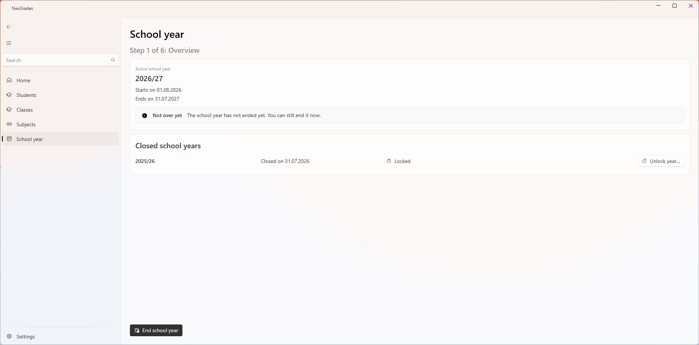
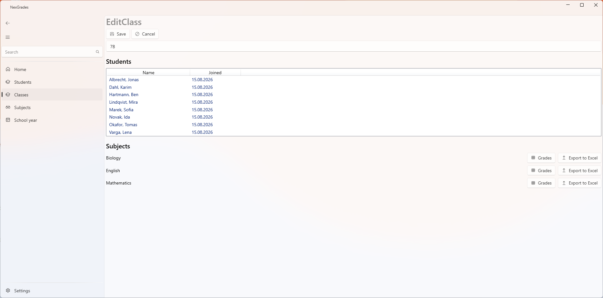
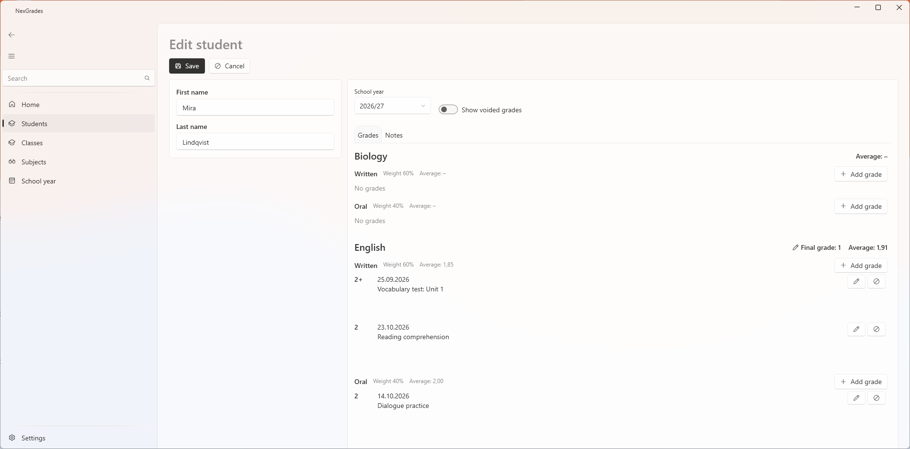

# NexGrades

NexGrades is a Windows grade book for teachers: school years, classes, students, weighted grades, final grades and
Excel export. It is for one user. Your data stays in a local database on your computer. There is no account and no
server.

## Screenshots

*School years: each year is Planned, Active or Closed.*

*A class page with its students and subjects.*

*The grade sheet of one subject.*

*The Grades tab of a student, for one school year.*

## What you can do

- Manage school years. Each year is Planned, Active or Closed. A readiness check lists what is still open before a
  year can be closed.
- Close a year and activate the next one in one step.
- A closed year is read-only. To correct it, choose **Unlock year…**, then give a reason and a time limit. **Lock
  again** makes it read-only again straight away.
- Changes made in an unlocked closed year are recorded in an audit trail.
- Keep classes, students with their class enrolment, and a subject catalogue.
- When you close a year, choose for each class either **Roll forward**, with the class name for the next year, or
  **Archive**.
- Keep a grade sheet per subject with assessments. Add, edit, void and restore assessments, and show voided grades.
- On a student's **Grades** tab, add single grades (without an assessment) and assessment grades, correct them, and
  void and restore them.
- Weighted grade buckets and averages. The weights are kept for each school year.
- Final grades: NexGrades proposes one from the subject average on the German 1–6 scale, with tendencies. You can
  override it with your own grade. Exempt students are shown as exempt.
- On a student's **Notes** tab, add, edit and archive notes, and show archived notes.
- Excel export: **Export to Excel** on the class page writes the overview of one subject. **Export notes…** on the
  Notes tab writes a student's notes for a date range, with or without archived notes.
- **Settings** > **Open log folder** opens the folder with the log files.

## Install

1. Open the [latest release](https://github.com/Nexusmeister/NexGrades/releases/latest). Use the release marked
   **Latest**. Pre-releases are betas for testing. Do not use them with real data.
2. Download `NexGrades-<version>-win-x64.zip`, where `<version>` is the version number in the release.
3. Unzip it into a folder of your own.
4. Run `NexGrades.App.exe` from that folder.

You do not need to install .NET. The app is self-contained and runs on 64-bit Windows.

Windows SmartScreen may warn when you start the app for the first time, because the app is not code-signed yet.
Choose **More info**, then **Run anyway**.

How releases are made is described in [docs/releasing.md](docs/releasing.md).

## Update

Updates are manual. Download the new zip from the latest release, then unzip it into a new folder or over the old
one. Your data is not stored in the app folder, so it is kept. The database upgrades itself the first time the new
version starts.

Before you update, copy `app.db` to a backup location. Keep the backup on encrypted media (see
[Data protection](#data-protection)).

## Where your data lives

- **Database:** `%LOCALAPPDATA%\NexGrades\app.db`. To open the folder, paste `%LOCALAPPDATA%\NexGrades` into the
  address bar of File Explorer.
- **Logs:** `%LOCALAPPDATA%\NexGrades\logs\`, or **Settings** > **Open log folder**. The app writes one log file per
  day and keeps up to 14 files. The app itself does not log pupil names, grades or notes. File paths in the logs
  include your Windows user name, and some error text from system components can contain values. Treat the log folder
  like the database. See [0003](docs/decisions/0003-application-logging.md).
- **Nothing is deleted.** Notes are archived, and grades and assessments are voided. You can restore any of them.

## Privacy

NexGrades works on your computer only. It has no account and sends no data by default. Telemetry (logs, metrics and
traces for developers) is off unless a developer sets the environment variable `OTEL_EXPORTER_OTLP_ENDPOINT`. The
app does not set it. Telemetry never carries pupil data. See
[0002](docs/decisions/0002-telemetry-and-privacy.md) and [0003](docs/decisions/0003-application-logging.md).

## Data protection

NexGrades stores grades and notes about students in a local SQLite database. The app does not encrypt
this file itself. Before you use it with real student data:

- Turn on device encryption for the drive that holds the database (BitLocker or Windows device
  encryption: Settings > Privacy & security > Device encryption, or BitLocker in Control Panel).
- Do not copy the database file or its backups to unencrypted media such as plain USB sticks or cloud folders.
- Check your state's and school's rules for student data on private devices. Many require the
  principal's approval.

Background and when this will be revisited: [docs/decisions/0001-encryption-at-rest.md](docs/decisions/0001-encryption-at-rest.md).

## For developers

To build, test and run NexGrades, see [CONTRIBUTING.md](CONTRIBUTING.md).

## License

NexGrades is released under the [MIT License](LICENSE).
