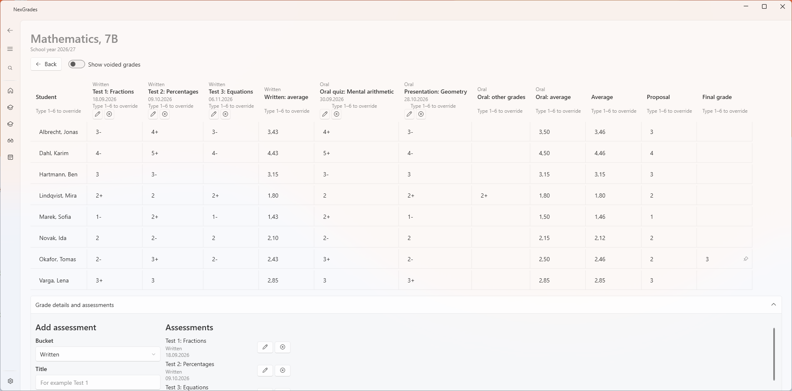

# NexGrades

NexGrades is a Windows grade book for teachers: school years, classes, students, weighted grades, final grades and
Excel export. It is for one user. Your data stays in a local database on your computer. There is no account and no
server.

## Screenshots

*School years: each year is Planned, Active or Closed.*

*A class page with its students and subjects.*

*The grade sheet of one subject.*

*The Grades tab of a student, for one school year.*

## What you can do

- Manage school years. Each year is Planned, Active or Closed. A readiness check lists what is still open before a
  year can be closed.
- Close a year and activate the next one in one step.
- A closed year is read-only. To correct it, choose **Unlock year…**, then give a reason and a time limit. **Lock
  again** makes it read-only again straight away.
- Changes made in an unlocked closed year are recorded in an audit trail.
- Keep classes, students with their class enrolment, and a subject catalogue.
- When you close a year, choose for each class either **Roll forward**, with the class name for the next year, or
  **Archive**.
- Keep a grade sheet per subject with assessments. Add, edit, void and restore assessments, and show voided grades.
- On a student's **Grades** tab, add single grades (without an assessment) and assessment grades, correct them, and
  void and restore them.
- Weighted grade buckets and averages. The weights are kept for each school year.
- Final grades: NexGrades proposes one from the subject average on the German 1–6 scale, with tendencies. You can
  override it with your own grade. Exempt students are shown as exempt.
- On a student's **Notes** tab, add, edit and archive notes, and show archived notes.
- Excel export: **Export to Excel** on the class page writes the overview of one subject. **Export notes…** on the
  Notes tab writes a student's notes for a date range, with or without archived notes.
- **Settings** > **Open log folder** opens the folder with the log files.

## Install

NexGrades runs on 64-bit Windows. You do not need to install .NET.

1. Open the [GitHub Releases page](https://github.com/Nexusmeister/NexGrades/releases) and use the release marked
   **Latest**. Pre-releases are betas for testing. Do not use them with real data.
2. Download one of these files. `<version>` is the version number of the release.
   - `NexGrades-<version>-win-x64-Setup.exe` (recommended). Run it to install NexGrades for your Windows user account.
     It goes into `%LOCALAPPDATA%\NexGrades.App`, and no administrator rights are needed.
   - `NexGrades-<version>-win-x64-Portable.zip`. Unzip it into a new folder for each version, then run
     `NexGrades.App.exe` from that folder. Your data is not kept in the app folder, so a new folder is safe.
3. Windows SmartScreen may warn the first time, because NexGrades is not code-signed yet. Choose **More info**, then
   **Run anyway**.

Automatic updates are confirmed only for the Setup.exe install. The portable zip has not been confirmed to update
itself (see [ADR 0004](docs/decisions/0004-application-updates.md)), so use the Setup.exe if you want updates to
install on their own.

If you used an earlier plain zip (`NexGrades-<version>-win-x64.zip`), install the Setup.exe or the portable zip once
by hand. The plain zip does not update itself and is no longer published.

## Updates

NexGrades checks for updates about ten seconds after it starts. A newer version downloads in the background and is
installed when you close the app. When an update is ready, the main window shows a notice with **Restart now**.
Choose it to install the update and start NexGrades again straight away. Restart now first asks the open page
whether you can leave it, so unsaved input is not lost.

You can change these settings under **Settings** > **Updates**:

- **Automatically check for updates**: check about ten seconds after the app starts. This is on by default.
- **Receive beta updates**: also offer beta pre-releases. Betas may contain unfinished features. This is off by
  default.
- **Check for updates now**: check straight away and show the result.

Turning beta updates off never moves you to an older version.

## Where your data lives

NexGrades keeps its data in `%LOCALAPPDATA%\NexGrades`. To open the folder, paste `%LOCALAPPDATA%\NexGrades` into the
address bar of File Explorer.

- `app.db`: the database, with your school years, classes, students, grades and notes.
- `backups\`: copies of the database, see [Backups](#backups).
- `logs\`: daily log files. **Settings** > **Open log folder** opens this folder. The app writes one log file per
  day and keeps up to 14 files. The app itself does not log pupil names, grades or notes. File paths in the logs
  include your Windows user name, and some error text from system components can contain values. Treat the log
  folder like the database. See [0003](docs/decisions/0003-application-logging.md).
- `settings.json`: the update and theme preferences.

Uninstalling the Setup.exe install removes the app folder `%LOCALAPPDATA%\NexGrades.App`. It keeps
`%LOCALAPPDATA%\NexGrades`, so your data stays.

Before you do anything risky, copy `app.db` with NexGrades closed. Keep the copy on encrypted media (see
[Data protection](#data-protection)).

Nothing is deleted. Notes are archived, and grades and assessments are voided. You can restore any of them.

## Backups

Before a migration of an existing database, NexGrades copies the database into `%LOCALAPPDATA%\NexGrades\backups`.
A migration runs when a new version changes the database. A new database, or one that is already up to date, is not
copied. Each backup is named `app-<date>-<time>-v<version>.db`, after the time it was taken and the version that last
used the database. Five backups are kept: the newest ones, plus the oldest backup taken for the same previous app version, which is pinned so repeated failed starts cannot rotate it out (see `docs/domain/updates-backups-and-settings.md`).

If the backup fails, NexGrades does not start and the database is unchanged. If a migration fails after the backup,
the startup message names the backup file.

NexGrades never restores a backup by itself. To restore one by hand:

1. Quit NexGrades.
2. Rename `%LOCALAPPDATA%\NexGrades\app.db` to keep it aside, for example `app.db.old`. Do the same with
   `app.db-wal`, `app.db-shm` and `app.db-journal`, whichever of them exist. SQLite can apply a leftover side file
   to the restored database, so the old ones must not stay next to it.
3. Make sure no `app.db-wal`, `app.db-shm` or `app.db-journal` is left next to `app.db`.
4. Copy the backup you want from `%LOCALAPPDATA%\NexGrades\backups\` into `%LOCALAPPDATA%\NexGrades\` and rename it
   to `app.db`.
5. Start NexGrades.

Backups contain the same data as the database, so the rules in [Data protection](#data-protection) apply to them too.

## Privacy

NexGrades works on your computer only. It has no account and sends no data by default. Telemetry (logs, metrics and
traces for developers) is off unless a developer sets the environment variable `OTEL_EXPORTER_OTLP_ENDPOINT`. The
app does not set it. Telemetry never carries pupil data. See
[0002](docs/decisions/0002-telemetry-and-privacy.md) and [0003](docs/decisions/0003-application-logging.md).

An update check is a request to GitHub. Apart from what any web request carries, such as your network address, it
sends nothing about you, your grades or your notes. See [0004](docs/decisions/0004-application-updates.md).

## Data protection

NexGrades stores grades and notes about students in a local SQLite database. The app does not encrypt
this file itself. Before you use it with real student data:

- Turn on device encryption for the drive that holds the database (BitLocker or Windows device
  encryption: Settings > Privacy & security > Device encryption, or BitLocker in Control Panel).
- Do not copy the database file or its backups to unencrypted media such as plain USB sticks or cloud folders.
- Check your state's and school's rules for student data on private devices. Many require the
  principal's approval.

Background and when this will be revisited: [docs/decisions/0001-encryption-at-rest.md](docs/decisions/0001-encryption-at-rest.md).

## For developers

To build, test and run NexGrades, and to publish a release, see [CONTRIBUTING.md](CONTRIBUTING.md).

## License

NexGrades is released under the [MIT License](LICENSE).
